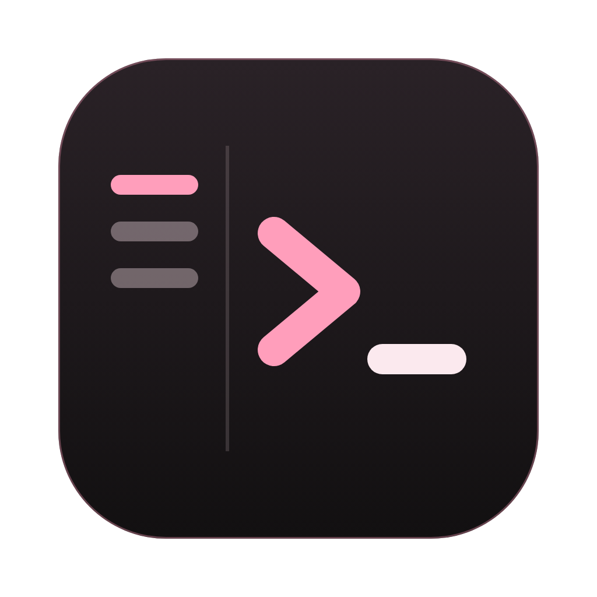

# terp

ターミナルを複数開いて、素早く切り替えるための macOS 用アプリ。左の一覧で開いているターミナルを確かめ、キー1つで切り替える。`claude`・`codex` などの CLI が、通常のターミナルと同じように動く。



## できること

- AI エージェントの考え中・許可待ち・終わったを一覧とタブに表示し、作業行の印・Dock の件数・`⌘⇧J` から要対応の端末を見つける。
- AI エージェントの応答の終わりやベルを macOS の通知で知らせ、押すと元の端末へ移る。通知条件と音は設定で変える。
- git の履歴を枝の線付きで閲覧し、検索・ファイルでの絞り込み・コミットの詳細と差分の表示ができる（`⌘⇧H`）。
- 左の一覧に、開いているターミナルの名前・動いているプログラム・作業場所・状態を出す。
- 左の一覧で Claude のサブエージェントと `codex exec` の動きを確かめ、Claude の記録をタブで読む。
- `claude` が端末のタイトルに出す会話の題名を、一覧の名前にする。応答が終わると、見ていないターミナルに通知の印を付ける。
- タブや一覧の項目をドラッグして画面を最大6枠に分け、境目で大きさを変える。`⌘\` で右に分割し、`⌘⌥` と矢印キーで隣の枠へ移る。
- Finder のファイルやフォルダを落として、ターミナルやエディタにパスを入力する。右のファイル一覧からは `⌥` を押しながら落とす。
- `⌘T` と一覧の下のボタンで、表示中と同じ作業場所に新しいターミナルを開く。
- `⌘1`〜`⌘9`・`⌃Tab`・`⌘⇧[`・`⌘⇧]` で切り替える。`⌘W` で閉じる。
- 右の「ファイル」から文字のファイルをタブで編集し、`⌘S` で保存する。外での変更を自動で取り込み、未保存の変更があれば確認する。
- ターミナルに出たファイルのパスをクリックしてタブで開き、指定された行・桁へ移る。フォルダは Finder で表示する。
- テーマ・強調色・フォント・背景の透過とぼかしを設定ファイルで変える。Ghostty のテーマをそのまま読む。
- 設定でテーマを絞り込み、プレビューで比べて選ぶ。3つの質問から、手元の claude で好みのテーマを作る。

## 動かす

macOS（Apple Silicon）と Node.js が要る。

```sh
npm install
npm start
```

`/Applications` に入れるときは次のどちらかを使う。

| コマンド | 入れ方 |
| --- | --- |
| `npm run link-app` | アプリがこのリポジトリのコードを直接読む。コードを直したら、terp を開き直すだけで反映される |
| `npm run install-app` | コードを同梱する |

署名の鍵が無いため、どちらも ad-hoc 署名で入れる。手元でビルドしたアプリは、そのまま Finder から起動できる。

## 設定

`⌘,` で設定の画面を開いて変える。変えたらすぐ反映される。設定は `~/.config/terp/config.json` に書かれ、手で書き換えても保存した瞬間に反映される（メニューの「設定ファイルを開く」で開ける）。画面に無い項目（`agents` など）は設定ファイルに書く。

```json
{
  "theme": "Catppuccin Mocha",
  "accent": null,
  "fontFamily": "\"JetBrains Mono\", Menlo, monospace",
  "fontSize": 14,
  "backgroundOpacity": 0.85,
  "backgroundBlur": 20
}
```

| 項目 | 内容 |
| --- | --- |
| `theme` | Ghostty のテーマの名前。`~/.config/terp/themes`・`~/.config/ghostty/themes`・Ghostty.app 付属のテーマの順に探す |
| `accent` | 強調色。`null` ならテーマのカーソルの色 |
| `backgroundOpacity` | 背景の不透明度（0.2〜1） |
| `backgroundBlur` | 窓の後ろのぼかし。`true`（半径 20）か半径の数値 |
| `agents` | 起動のボタンに足す AI エージェント。`[{ "command": "名前か絶対パス", "label": "表示名", "args": "引数", "bypassArgs": "確認を飛ばす引数" }]`。claude・codex などよく使われるものは書かなくても探す |
| `skipApprovals` | `true` なら、エージェントをファイルの読み書きやコマンドの実行の確認なしで起動する（claude は `--dangerously-skip-permissions` など）。⌥ を押しながらボタンを押すと逆になる。既定は `false` |
| `mainAgent` | タブの並びの隣のボタンで、プルダウンなしで起動するエージェントの `command`。書かなければ、見つかった最初のもの |

ぼかしは macOS の非公開の関数（`CGSSetWindowBackgroundBlurRadius`）を呼んでいる。macOS の更新で使えなくなった場合は、ぼかしだけが無くなり、透過は残る。

## 設計

方針・採らなかった案・既知の落とし穴は [docs/design.md](docs/design.md) にまとめている。

## ライセンス

[MIT](LICENSE)

エージェントのアイコンは [Lobe Icons](https://github.com/lobehub/lobe-icons)（MIT）を使用している。
各ロゴは各社の商標であり、terp は各社と関係がない。詳細は [NOTICE.md](src/renderer/icons/agents/NOTICE.md) を参照。
